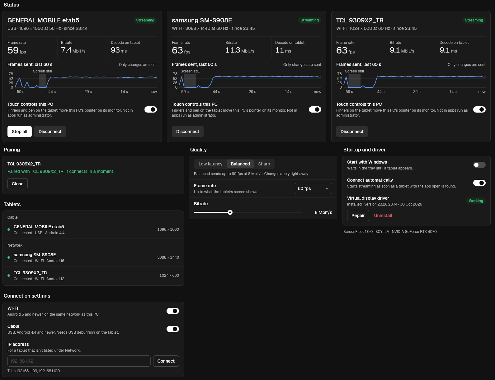

# ScreenFleet

Turns the Android tablets and phones in your drawer into real extra monitors
for a Windows PC, over USB or Wi-Fi. Each device becomes its own display in
Windows: drag windows onto it, touch it, use a pen. Connect several at once.
No cloud, no account, no subscription.

**[Website + downloads](https://harunethm.github.io/screenfleet/)** · **[Releases](https://github.com/harunethm/screenfleet/releases)**



*A real session: an Android 4.4 tablet over USB and two Android 12/16 devices
over Wi-Fi, streaming at the same time.*

## Get it

| | Download | Needs |
|---|---|---|
| Windows app + display driver | [ScreenFleet-1.0.0-setup.exe](https://github.com/harunethm/screenfleet/releases/download/v1.0.0/ScreenFleet-1.0.0-setup.exe) (2.4 MB) | Windows 10 2004+ or 11, 64-bit |
| Android app | [ScreenFleet-1.0.0.apk](https://github.com/harunethm/screenfleet/releases/download/v1.0.0/ScreenFleet-1.0.0.apk) (177 KB) | Android 4.4+, tablet or phone |

1. Run the setup on the PC. It installs the app and the virtual display
   driver; Windows asks for administrator rights once.
2. Install the APK on each tablet or phone and open it.
3. Connect: plug it in with USB debugging on (needs
   [platform-tools](https://developer.android.com/tools/releases/platform-tools)
   on the PC; the only option on Android 4.4), or, on Android 5+, pair it over
   Wi-Fi with the 6-digit code it shows.

SmartScreen may warn about the setup because it isn't signed with a paid
certificate yet: choose *More info*, then *Run anyway*. Checksums are in
`SHA256SUMS.txt` on the release.

## Features

- **A real monitor** for each device, through a virtual display driver:
  extend, snap, full-screen apps, or duplicate a monitor onto it.
- **Several devices at once**, USB and Wi-Fi mixed.
- **Touch and pen** control the PC on that monitor (hover, pressure, barrel
  button, eraser).
- **Hardware all the way:** captured, scaled and H.264-encoded on the PC's
  GPU (NVIDIA, AMD, Intel), decoded in hardware on the device. Up to 60 fps;
  only changes are sent.
- **Old devices welcome:** Android 4.4 is supported on purpose.

## Privacy and the driver

There is no ScreenFleet server: the PC talks straight to the device over the
cable or your own network. Over Wi-Fi, devices pair once with a 6-digit code
(ECDH P-256) and every session is encrypted (AES-256-GCM); the PC only
streams to devices it has paired with.

Windows only loads signed drivers. Instead of shipping a shared signing key,
Setup creates a certificate for your PC only, signs the driver with it and
deletes the private key at once, so nobody (the author included) can sign
anything else with it. Uninstalling removes the driver and the certificate.

## What's here

| Folder | What it is | Status |
|---|---|---|
| [`host-windows/`](host-windows/README.md) | Windows app (C++): capture → GPU encode → stream | 1.0.0 |
| [`driver/`](driver/README.md) | Virtual monitor driver (C++, IddCx), signed on each PC | 1.0.0 |
| [`android/`](android/README.md) | Android app (Java, minSdk 19) | 1.0.0 |
| [`protocol/`](protocol/PROTOCOL.md) | Wire protocol shared by host and app | v1 |
| [`installer/`](installer/) | Windows installer (Inno Setup): app + driver | 1.0.0 |
| [`host-mac/`](host-mac/README.md) | macOS host | not started, contributions welcome |
| [`ios/`](ios/README.md) | iOS / iPadOS app | not started, contributions welcome |

Each folder's README has build instructions. `installer\build.cmd` builds the
app, the driver and the setup in one go; `installer\package.cmd` makes the
release folder (the Android release key stays outside the repo, see
`android/app/build.gradle`).

## How it works

```
Windows PC                                              Tablet
┌──────────────────────────────────────────┐           ┌──────────────────────┐
│ virtual monitor → Desktop Duplication    │  USB/adb  │ MediaCodec (hardware │
│   → GPU scale + NV12 → hardware H.264    │ ───────▶  │  H.264 decoder)      │
│   (NVENC / AMD / Intel via Media Found.) │  or Wi-Fi │   → full-screen view │
│                       ◀── touch / pen ───│ ◀──────── │                      │
└──────────────────────────────────────────┘           └──────────────────────┘
```

- USB for Android 4.4 (`adb forward`), Wi-Fi or USB for Android 5+.
- The picture stays on the GPU from capture to encoder; nothing is copied
  through the CPU.
- No B-frames, low-latency encoder mode, frames sent only when the screen
  changes.

## Contributing

Issues and pull requests are welcome, from bug reports to a whole macOS host
or iOS app. See [Issues](https://github.com/harunethm/screenfleet/issues).

MIT licensed, see [LICENSE](LICENSE).
